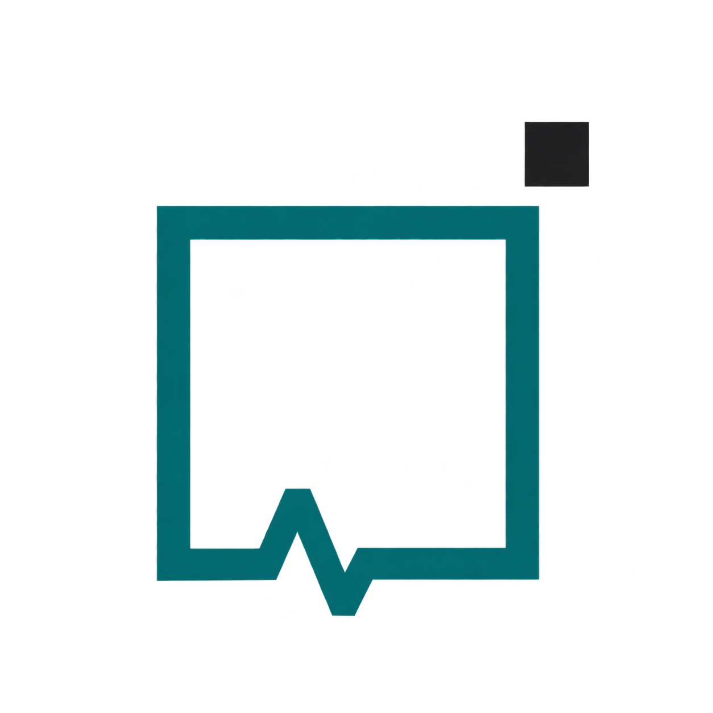
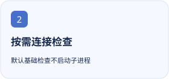
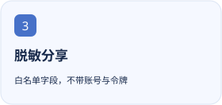

<p align="center"></p>

<h1 align="center">DSH Provider Doctor</h1>

<p align="center">沿着宿主、安装、注册、凭据与目录逐环取证，定位 DSH 模型连接断在哪里。</p>

<p align="center"><a href="https://github.com/tangyixiao/dsh-provider-doctor"></a></p>

<p align="center"><a href="README.md">简体中文</a> · <a href="README.en.md">English</a></p>

[](https://github.com/tangyixiao/dsh-provider-doctor/stargazers) [](https://github.com/tangyixiao/dsh-provider-doctor/actions/workflows/check.yml) [](LICENSE) [](https://www.npmjs.com/package/dsh-provider-doctor)

<p align="center">
  <picture><source media="(prefers-color-scheme: dark)" srcset="docs/assets/feature-1-zh-CN-dark.svg"></picture>
  <picture><source media="(prefers-color-scheme: dark)" srcset="docs/assets/feature-2-zh-CN-dark.svg"></picture>
  <picture><source media="(prefers-color-scheme: dark)" srcset="docs/assets/feature-3-zh-CN-dark.svg"></picture>
</p>

## 开始使用

Desktop：从发行页下载 `.tgz`，在“扩展 → 插件管理 → 添加插件”中安装。命令行示例用于你明确控制的 Web profile：

```sh
dsh plugin --profile web add dsh-provider-doctor@0.1.9
```

打开左侧 Provider Doctor，先运行基础检查。只有显式选择连接检查才会运行 provider 的诊断命令；ZCode 读取目录可能启动 app-server。

## 当前状态与兼容性

| 项目 | 当前依据 |
| --- | --- |
| 源码版本 | `0.1.9` · 以 [package.json](package.json) 为准 |
| 分发方式 | `npm` · [Releases](https://github.com/tangyixiao/dsh-provider-doctor/releases) |
| DSH | `0.2.2-rc.1 \|\| 0.2.2-rc.3` |
| Node.js | `^22.19.0 \|\| >=24.0.0` |
| 开发状态 | [Open issues](https://github.com/tangyixiao/dsh-provider-doctor/issues?q=is%3Aissue+is%3Aopen) · [CI](https://github.com/tangyixiao/dsh-provider-doctor/actions) |

本插件只诊断，不修复配置、不代为登录，也不发送消耗额度的模型请求。报告中的 `not checked` 不能当作通过。

[详细使用、配置与故障排查](docs/guide.zh-CN.md)

## 开发与参与

```sh
pnpm install --frozen-lockfile
pnpm run check
node tools/check-repository.mjs
```

[Contributing](CONTRIBUTING.md) · [Support](SUPPORT.md) · [Questions](https://github.com/tangyixiao/dsh-provider-doctor/discussions) · [Report a bug](https://github.com/tangyixiao/dsh-provider-doctor/issues/new/choose) · [Security](SECURITY.md) · [Maintenance](docs/maintenance.md)

## Star History

<picture><source media="(prefers-color-scheme: dark)" srcset="https://api.star-history.com/chart?repos=tangyixiao/dsh-provider-doctor&amp;type=date&amp;theme=dark&amp;legend=top-left"></picture>

[Interactive chart](https://www.star-history.com/?repos=tangyixiao%2Fdsh-provider-doctor&type=date) · [GitHub Stars](https://github.com/tangyixiao/dsh-provider-doctor/stargazers)

图表由外部服务按真实星标数据生成，可能缓存或暂时不可用；未填造开发百分比。

## 来源与许可

[Software license](LICENSE) · [Logo artwork and attribution](assets/NOTICE.md)

软件保持原许可证；鲸鱼娘衍生美术单独采用 CC BY-NC-SA 4.0，并保留上善、ZipZipPipe、Small-tailqwq 的署名链。
